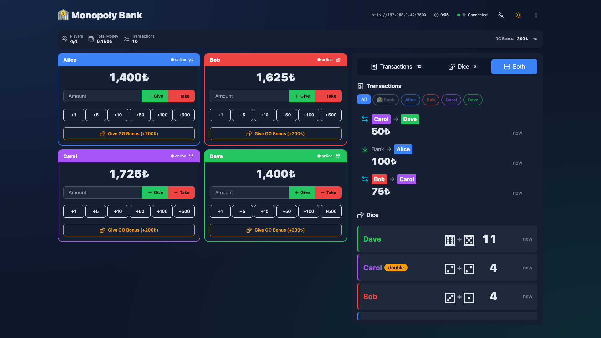
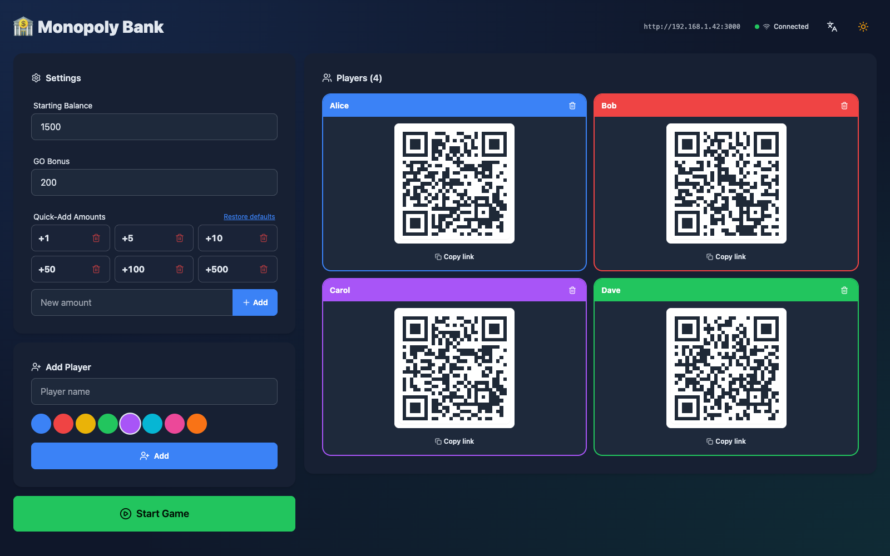
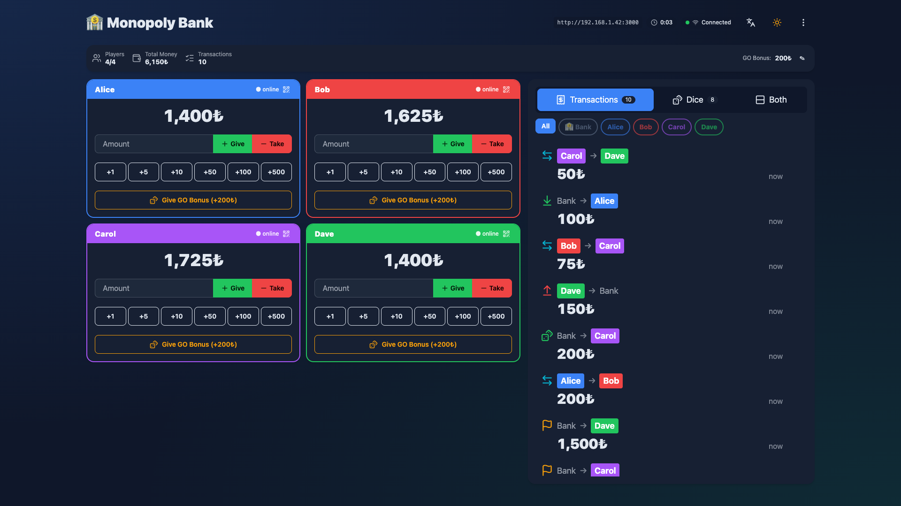
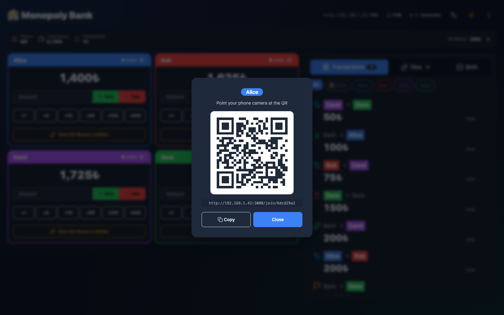
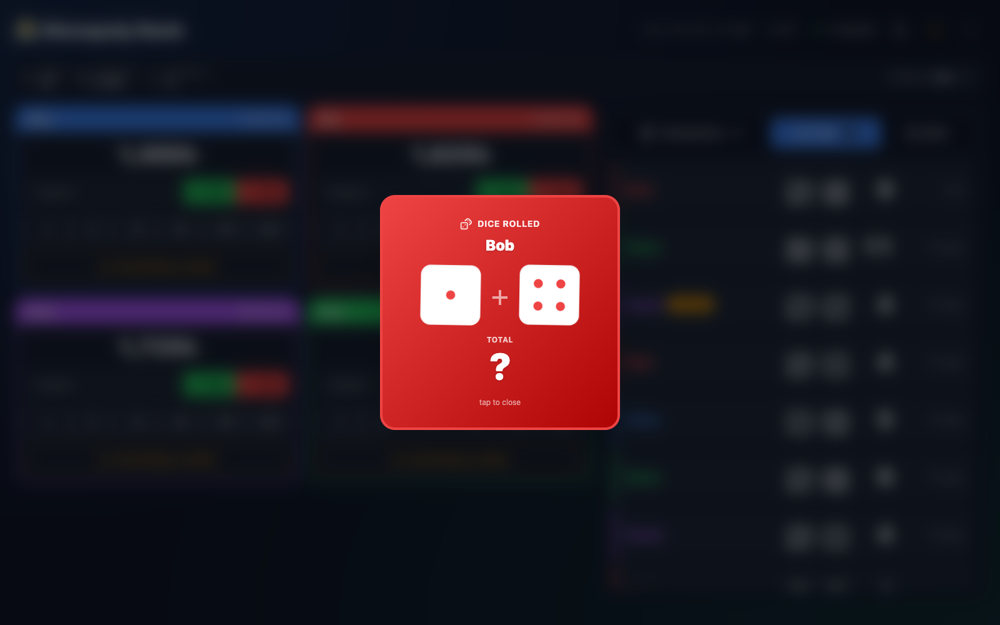
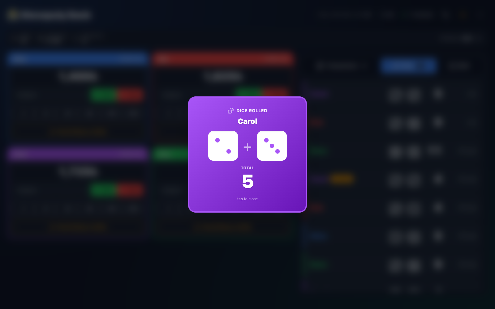
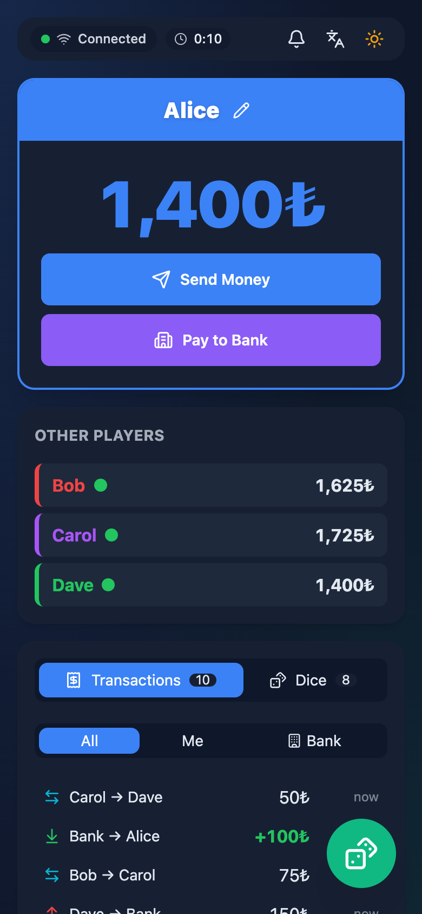
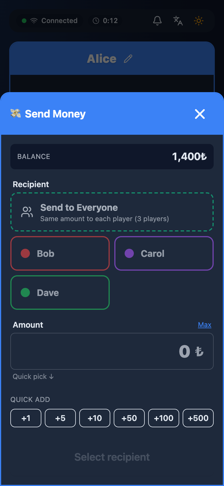
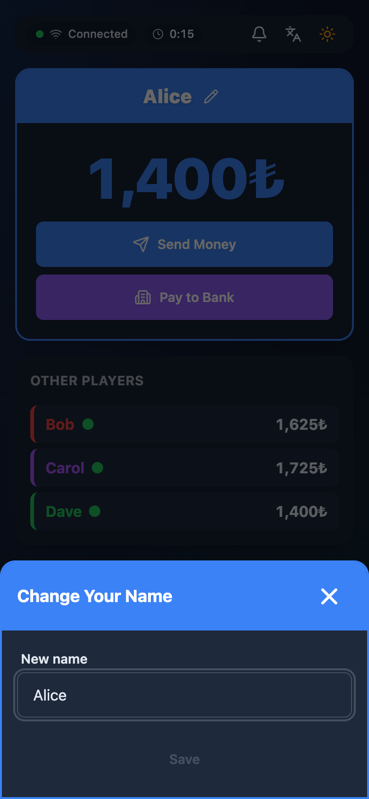
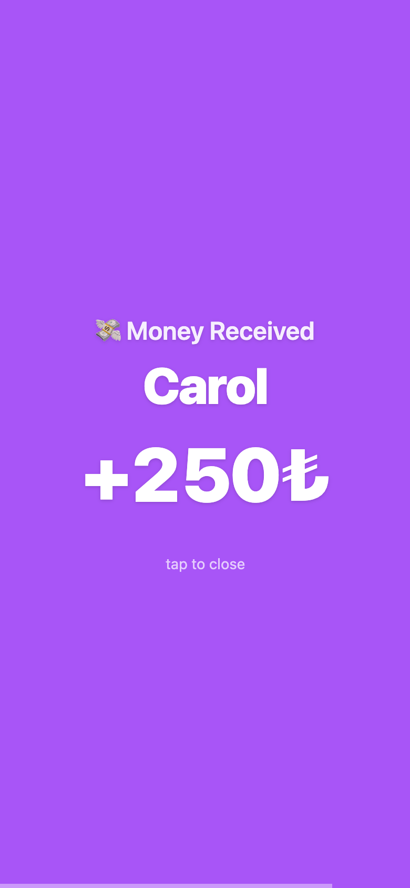

# Monopoly Bank

A money manager for Monopoly on the local network. The banker runs the game on a computer, and each player uses their own phone, joining by scanning a QR code. It needs no internet connection and no account, but the computer and all phones must be on the same network (for example the same Wi-Fi).

<p align="center">
  
</p>

## Features

### Banker

- Set the starting balance, the GO bonus and the quick-add amounts before the game starts. Amounts are shown in ₺; the interface has no currency setting.
- Add players with a name and a color. Each player gets a personal join link and QR code. At least 2 players are needed to start.
- Give money to or take money from any player, using typed amounts or the quick-add buttons. Taking more than a player has is refused.
- Grant the GO bonus to a player with one button. Only the banker can do this. The bonus amount can be changed during the game.
- Undo any transaction. Undone transactions stay in the history, crossed out.
- Watch the history as Transactions, Dice, or Both. The Both view uses large text and large dice so it can be shown on a projector. Transactions can be filtered by player or by bank.
- Show a player's QR code again during the game, so they can rejoin on a new phone or after clearing their browser data.
- See who is online, the number of players, total money in the game, and a game timer.
- Reset the whole game from the menu.

### Players

- See your balance and the other players.
- Send money to one player, or the same amount to every other player at once. A "Max" link fills in your full balance.
- Pay money to the bank, for taxes, property purchases and similar.
- Roll the dice. The result appears on every connected screen. Only players roll; the banker screen shows the rolls.
- Change your own name after the game has started. Names can be up to 24 characters, and two players cannot have the same name (upper and lower case count as the same).
- Get a full-screen notification in the sender's color, a short sound and a vibration when money arrives (vibration depends on the phone and browser). Sound can be muted from the top bar.
- Keep the phone screen awake while the page is open, where the browser supports it.

### Shared

- Seven languages: Turkish, English, Spanish, German, French, Italian and Brazilian Portuguese. The language is picked from the browser and can be switched on screen.
- Light and dark theme.
- Every transaction and dice roll is visible to everyone, as with real cash on the table.
- The game is saved to a JSON file (`game-state.json`) after every change, so it survives a restart of the server. The last 50 dice rolls are kept.

## Screenshots

All screenshots are from a demo game with four players.

**Banker**



*Setup: game settings, players, and one join QR code per player.*



*A running game with the Transactions view.*



*The in-game QR dialog, for letting a player rejoin.*

**Dice**

<table>
  <tr>
    <td align="center"></td>
    <td align="center"></td>
  </tr>
  <tr>
    <td align="center"><em>The result is hidden during the 2-second roll.</em></td>
    <td align="center"><em>Then the dice, the total and any doubles badge are shown.</em></td>
  </tr>
</table>

**Player phone**

<table>
  <tr>
    <td align="center"></td>
    <td align="center"></td>
    <td align="center"></td>
    <td align="center"></td>
  </tr>
  <tr>
    <td align="center"><em>Home</em></td>
    <td align="center"><em>Send Money</em></td>
    <td align="center"><em>Rename</em></td>
    <td align="center"><em>Money received</em></td>
  </tr>
</table>

## Getting started

Requirements: Node.js. The repository has no `engines` field. The frontend tooling (Vite 5) runs on Node 18 or 20 and newer, and the desktop app bundles Electron 33, which ships its own Node 20 runtime; Node 20 or newer is the safe choice.

```bash
npm install
npm run build   # builds the frontend into public/
npm start       # starts the server
```

The server listens on port 3000 and prints the banker and player addresses with your local network IP, plus a QR code for the banker address. Open the printed `/banker` URL on the computer.

To use another port:

```bash
PORT=4000 npm start
```

`npm run build` must be run at least once before `npm start`, and again after changing anything in `client/`. The `public/` folder is generated and not committed.

## How to play

1. Start the server and open the `/banker` URL on the computer.
2. In Settings, check the starting balance, GO bonus and quick-add amounts.
3. Add each player with a name and a color. A QR code appears for each one.
4. Each player scans their own QR code with the phone camera. This opens the player page and remembers the player in a browser cookie. The player shows as online on the banker screen.
5. Press Start Game. Everyone receives the starting balance and the game timer starts.
6. During play, players send money to each other and pay the bank from their phones. The banker handles GO bonuses and any manual corrections, and can undo mistakes.
7. To roll, a player taps Roll Dice. Everyone sees the dice for 2 seconds of animation, then the result.

If a player closes the page and loses the link, the banker can show their QR code again from the player card.

## Desktop app

The project also builds as an Electron desktop app that runs the server inside the app and opens the banker screen directly.

```bash
npm run electron        # builds the frontend, then opens the app
npm run electron:dev    # opens the app with DevTools; needs an existing build
npm run dist:mac        # installer (dmg, x64 and arm64) into dist-electron/
npm run dist:win        # installer (NSIS, x64) into dist-electron/
npm run dist:linux      # AppImage (x64) into dist-electron/
```

Notes:

- The installers are not code-signed (`identity: null` for macOS), so macOS shows a security warning on first launch.
- The app prefers port 3737 and falls back to a free port if that one is taken. A fixed port keeps the join address and the saved theme and language the same between launches.
- Game data is stored in the operating system's user-data folder for the app, not in the project folder. The File menu has an item that shows the data file in your file manager. The menu labels are in Turkish: the item is "Veri Klasörünü Aç". Another item, "LAN URL'sini Göster", shows the address phones should use.
- Only one instance of the app can run at a time.

## Projector tip

The Both history view fits a 1920x1080 screen without scrolling the page. On 1280x720 it needs scrolling. In the desktop app, the View menu (labeled "Görünüm") has zoom in, zoom out and reset zoom, which helps to fit a given screen.

## Development

```bash
npm run dev:client   # Vite dev server with hot reload for the frontend
npm run build        # builds the frontend into public/
npm test             # 29 tests: locale checks, game logic and server start
npm run lint         # React hooks rules (eslint)
```

| Path | Contents |
| --- | --- |
| `client/src/` | React frontend: banker, player and join pages, dice and QR components, hooks, and the translation files in `locales/` |
| `server/` | Game logic, state handling, JSON persistence, HTTP routes and Socket.IO handlers |
| `server.js` | Server entry point, used by both the command line and the desktop app |
| `electron/` | Electron main process |
| `tests/` | `static/` (locale checks), `unit/` (game logic) and `integration/` (server start) tests |
| `public/` | Built frontend. Generated by `npm run build` and listed in `.gitignore` |

The stack is Node.js with Express and Socket.IO on the server, and Vite, React, Tailwind and DaisyUI on the client.

## Security

This app is meant for a trusted home network. There is no login. Anyone who can reach the server on the network can open the banker page and perform banker actions, and `/api/state` returns the full game state, including every player's join token. A token is all that is needed to act as that player. Do not expose the server to the internet.

## Trademark

This is an unofficial fan project, not affiliated with or endorsed by Hasbro, owner of the MONOPOLY trademark.

## License

MIT, see [LICENSE](LICENSE). Changes are listed in [CHANGELOG.md](CHANGELOG.md).
